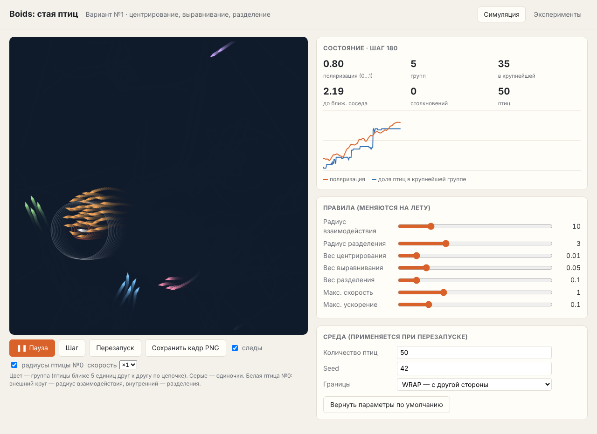

# Лабораторная работа: Boids — стая птиц (Вариант №1)

Java 17+, Spring Boot 3.5, Maven. Симуляция считается на сервере (Java),
визуализация — в браузере на `<canvas>`.



## Как запустить

```bash
mvn spring-boot:run
```

Откройте http://localhost:8080 и нажмите **▶ Старт**.

- В IntelliJ IDEA: открыть папку как Maven-проект и запустить `BoidsApplication`.
- Тесты: `mvn test`.
- Параметры по умолчанию меняются в `src/main/resources/application.yml` без правки кода.
- В браузере ползунки меняют веса и радиусы на лету. Количество птиц, seed и границы применяются кнопкой «Перезапуск».
- Вкладка **Эксперименты** прогоняет все опыты из задания за ~1–2 секунды. Таблицу можно скачать в CSV (открывается в Excel), а кнопка «Смотреть» показывает любой эксперимент вживую.
- Кнопка «Сохранить кадр PNG» сохраняет скриншот для отчёта.

## Структура проекта

```
src/main/java/lab/boids/
├── BoidsApplication.java        точка входа Spring Boot
├── config/SimulationConfig.java читает секцию boids из application.yml
├── model/
│   ├── Vector2D.java            2D-вектор: add, sub, mul, length, limit
│   ├── Boid.java                птица: позиция + скорость
│   ├── BoundaryMode.java        WRAP или BOUNCE
│   └── SimulationParams.java    все параметры среды, агентов и правил
├── engine/                      ← ядро, не зависит от Spring
│   ├── BoidsSimulation.java     алгоритм Boids: шаг симуляции
│   └── FlockMetrics.java        метрики стаи
├── service/
│   ├── SimulationService.java   хранит «живую» симуляцию для браузера
│   ├── ExperimentService.java   серия экспериментов
│   └── SimulationState.java     JSON-ответ для браузера
└── web/SimulationController.java REST API
src/main/resources/
├── application.yml              параметры по умолчанию
└── static/index.html            визуализация
```

Роли слоёв:

| Слой | Что делает |
|---|---|
| `model` | данные |
| `engine` | математика |
| `service` | хранение состояния и эксперименты |
| `web` | HTTP |

Браузер раз в кадр шлёт `POST /api/step`. Сервер делает шаг и возвращает координаты птиц и метрики, а браузер их рисует.

## Модель

| | |
|---|---|
| Среда | плоскость 100 × 100 условных единиц |
| Границы | WRAP (вылетел справа — появился слева) или BOUNCE (отражение) |
| Агент | точка с позицией **p** и скоростью **v** |
| Старт | 50 птиц, случайные позиции и направления, скорость 0.3…1.0 |
| Ограничения | скорость от 0.3 до 1.0 единиц/шаг, ускорение ≤ 0.1 |
| Время | дискретное, 1 шаг = 1 кадр |

Допущения:
- У птицы круговой обзор без «слепой зоны» сзади.
- Минимальная скорость больше нуля, потому что птица не может зависнуть.
- В режиме WRAP расстояния считаются через край мира, поэтому птицы у левой и правой стенки — соседи.

### Метрики

| Метрика | Смысл |
|---|---|
| **Поляризация** | длина среднего единичного вектора скорости: 1 — все летят в одну сторону, ≈0 — хаос |
| **Групп** | число связных групп (птицы ближе 5 ед. друг к другу по цепочке; union-find) |
| **В крупнейшей** | сколько птиц в самой большой группе |
| **До ближайшего соседа** | средняя дистанция до ближайшей птицы: чем меньше, тем плотнее стая |
| **Столкновения** | число пар птиц ближе 1 ед. |

## Эксперименты

Условия: 50 птиц, 500 шагов, 5 запусков с разными seed. Метрики усреднены по шагам 401–500, когда стая уже сформировалась. Базовые параметры: R = 10, r = 3, wC = 0.01, wA = 0.05, wS = 0.1, WRAP. В каждой строке меняется только указанный параметр.

### A. Радиус взаимодействия

| R | Поляризация | Групп | В крупнейшей | До соседа | Столкн./шаг |
|---|---|---|---|---|---|
| 2  | 0.18 | 41.1 | 3.2  | 7.19 | 0.14 |
| 5  | 0.51 | 7.7  | 19.4 | 3.22 | 0.09 |
| 10 | 0.87 | 2.6  | 27.8 | 2.36 | 0.01 |
| 20 | 0.88 | 1.8  | 38.5 | 1.94 | 0.81 |
| 40 | 1.00 | 1.0  | 50.0 | 1.69 | 0.00 |

**Наблюдение.**
- При R = 2 птицы почти не видят друг друга и летают поодиночке (41 «группа» из 50 птиц).
- С ростом R стаи укрупняются и выравниваются.
- При R = 40 (почти весь мир) образуется одна стая из всех 50 птиц, и все летят строго в одну сторону (поляризация 1.00).
- Плата за большой радиус — более плотная стая (дистанция до соседа падает с 7.2 до 1.7).

### B. Веса правил (R = 10)

| Веса | Поляризация | Групп | В крупнейшей | До соседа | Столкн./шаг |
|---|---|---|---|---|---|
| Базовые: C=0.01, A=0.05, S=0.1 | 0.87 | 2.6  | 27.8 | 2.36 | 0.01 |
| Без правил: 0 / 0 / 0           | 0.10 | 41.6 | 3.0  | 7.12 | 0.40 |
| Только разделение: S=0.1        | 0.13 | 41.1 | 3.2  | 7.01 | 0.26 |
| Без разделения: S=0             | 0.69 | 3.4  | 27.7 | 0.00 | 465.38 |
| Без выравнивания: A=0           | 0.31 | 20.9 | 10.6 | 4.14 | 0.81 |
| Без центрирования: C=0          | 0.87 | 18.0 | 18.4 | 4.48 | 0.03 |
| Сильное центрирование: C=0.05   | 0.43 | 2.9  | 31.6 | 1.38 | 10.43 |
| Сильное разделение: S=0.5       | 0.68 | 2.4  | 34.3 | 2.93 | 0.00 |

**Наблюдения.**
- **Базовые веса** дают устойчивую стаю: птицы летят согласованно (0.87), группы сливаются, столкновений практически нет.
- **Без правил** и **только с разделением** движение хаотично: стаи нет.
- **Без разделения** птицы «схлопываются» в точку: дистанция до соседа 0, сотни столкновений за шаг. Разделение — единственное, что держит дистанцию.
- **Без выравнивания** птицы сбиваются в кучки, но летят в разные стороны (поляризация 0.31). Стаи распадаются и собираются снова.
- **Без центрирования** птицы летят параллельно, но не стягиваются в одну стаю: 18 мелких «ручейков» вместо 2–3 групп.
- **Сильное центрирование** делает стаю слишком плотной («рой»): много столкновений, птицы кружат вокруг центра, и упорядоченность падает.
- **Сильное разделение** даёт более разреженную стаю без столкновений, но немного менее согласованную.

### C. Границы

| Режим | Поляризация | Групп | В крупнейшей | До соседа | Столкн./шаг |
|---|---|---|---|---|---|
| WRAP   | 0.87 | 2.6 | 27.8 | 2.36 | 0.01 |
| BOUNCE | 0.68 | 2.1 | 35.1 | 2.06 | 0.44 |

**Наблюдение.** При отражении стая постоянно разворачивается у стенок, и часть птиц летит навстречу остальным. Поэтому поляризация ниже, а столкновений больше. Зато стены «сгоняют» птиц вместе, и крупнейшая группа больше.

## Выводы

1. Три простых локальных правила без какого-либо лидера дают сложное коллективное поведение — стаю.
2. Каждое правило отвечает за своё свойство стаи:
   - центрирование — за то, что стая держится вместе;
   - выравнивание — за общее направление полёта;
   - разделение — за дистанцию и отсутствие столкновений.
   Если убрать любое из них, теряется соответствующее свойство.
3. Радиус взаимодействия определяет масштаб: малый даёт одиночек, средний — несколько стай, большой — одну общую стаю.
4. Баланс весов важен. Слишком сильное центрирование ведёт к давке и столкновениям, слишком сильное разделение — к рыхлой стае. Веса из задания (0.01 / 0.05 / 0.1) дают устойчивое согласованное движение.