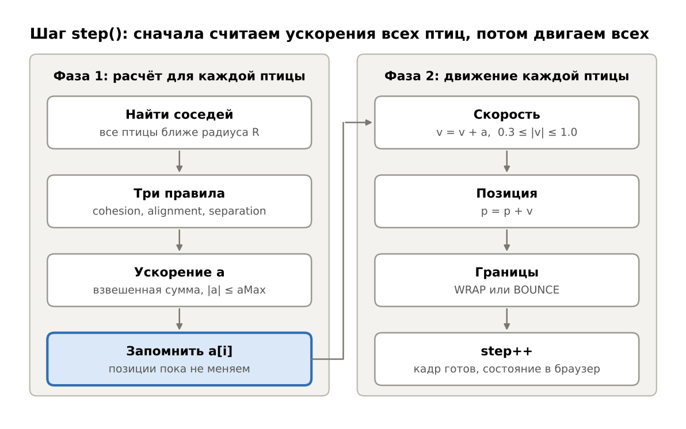
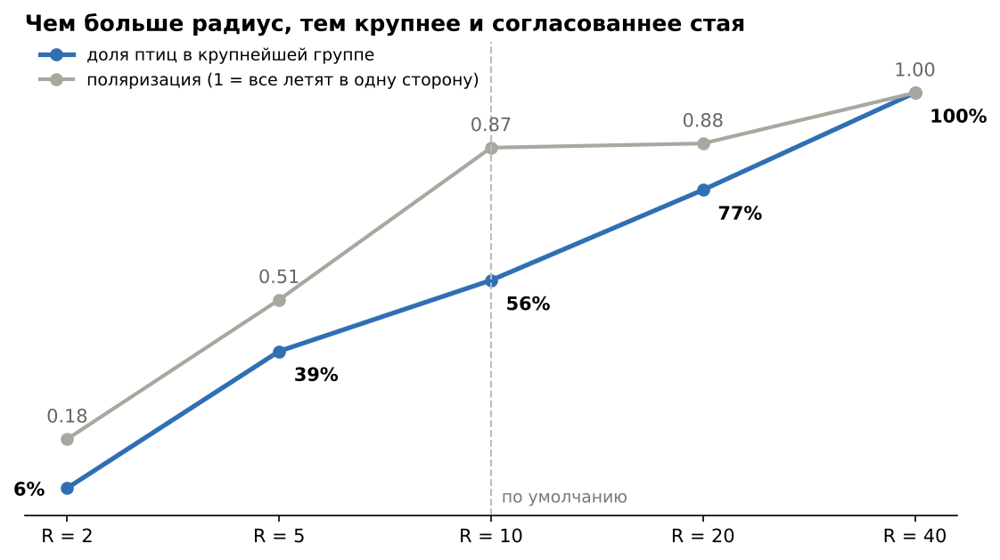

# Лабораторная работа: моделирование стаи птиц (Boids)

**Вариант 1:** стая птиц, три базовых правила Boids.
**Язык:** Java 17, Spring Boot 3.5, Maven. **Проект:** `boids-lab`, ядро - `BoidsSimulation.java`

## 1. Цель

Реализовать агентную модель стаи птиц по алгоритму Boids и показать, что три простых локальных правила дают согласованное движение стаи. Исследовать, как на поведение стаи влияют радиус взаимодействия, веса правил и способ обработки границ среды.

## 2. Идея алгоритма

У настоящей стаи нет вожака и общего плана: каждая птица видит только ближайших соседей. **Boids** (Крейг Рейнольдс, 1986) моделирует это методом **агентного моделирования**: мы описываем не стаю, а одну птицу и правила её реакции на соседей, а затем запускаем много таких птиц одновременно. Стая возникает сама, хотя в коде её нет. Это свойство называется **эмерджентностью**.

**Модель.** Птица - точка с позицией **p** и скоростью **v**. Среда - плоскость 100 × 100. Время дискретное: 1 шаг = 1 кадр. Старт: 50 птиц в случайных точках со случайным направлением и скоростью 0.3–1.0.

> **Соседи** - птицы ближе радиуса взаимодействия **R = 10**. Об остальных птица ничего не знает.
> **Радиус разделения r = 3** - «личное пространство», в которое нельзя залетать.
> **Веса** - насколько сильно каждое правило влияет на птицу. Радиусы решают, **кого** птица учитывает, веса - **насколько сильно**.

Три правила для птицы *i* с N соседями:

| Правило | Формула | Смысл | Вес |
|---|---|---|---|
| Центрирование (cohesion) | (1/N) · Σ (pⱼ − pᵢ) | лететь к центру соседей, стая держится вместе | wC = 0.01 |
| Выравнивание (alignment) | (1/N) · Σ vⱼ − vᵢ | лететь в ту же сторону, что соседи | wA = 0.05 |
| Разделение (separation) | −Σ (pⱼ − pᵢ) / d², только для d < r | не подлетать слишком близко; сила ∝ 1/d | wS = 0.1 |

Итоговое ускорение и обновление птицы за один шаг:

```
a = limit(wC · cohesion + wA · alignment + wS · separation, aMax)
v = clamp(v + a, vMin, vMax)
p = p + v
```

Ограничения общие для всех птиц: aMax = 0.1 (нельзя развернуться мгновенно), скорость от 0.3 (нельзя зависнуть) до 1.0. Разделению дан самый большой вес: избежать столкновения важнее, чем держаться вместе. У центрирования вес самый маленький, потому что его вектор длинный (до 10 единиц) и иначе задавил бы остальные.

**Границы.** WRAP: вылетела справа - появилась слева, расстояния считаются через край мира. BOUNCE: отражение от стенки.

## 3. Логика кода

Симуляция считается на сервере (Java), браузер только рисует птиц на `<canvas>`. Каждый кадр браузер шлёт `POST /api/step`, сервер делает шаг и возвращает координаты птиц и метрики в JSON.

| Элемент | Назначение |
|---|---|
| `Vector2D` | двумерный вектор: сложение, длина, `limit` (обрезать до максимума) |
| `Boid` | птица: позиция + скорость |
| `SimulationParams` | все параметры среды, агентов и правил; значения по умолчанию из `application.yml` |
| `BoidsSimulation` | ядро: `step()`, `computeAcceleration()`, обработка границ; не зависит от Spring |
| `FlockMetrics` | метрики стаи: поляризация, группы (union-find), дистанция, столкновения |
| `SimulationService` | хранит «живую» симуляцию для браузера |
| `ExperimentService` | серии экспериментов: 500 шагов × 5 seed, усреднение |
| `SimulationController` | REST API: `/api/step`, `/api/reset`, `/api/params`, `/api/experiments` |

**Метрики стаи.** **Поляризация** - длина среднего единичного вектора скорости: 1 - все летят в одну сторону, ≈ 0 - хаос. **Группа** - птицы ближе 5 единиц друг к другу по цепочке. **Столкновение** - пара птиц ближе 1 единицы. Также считаются размер крупнейшей группы и среднее расстояние до ближайшего соседа.

Ядро алгоритма - расчёт ускорения одной птицы (`BoidsSimulation.computeAcceleration`):

```java
for (Boid other : boids) {
    if (other == self) continue;
    Vector2D toOther = offset(self.getPosition(), other.getPosition());
    double dist = toOther.length();
    if (dist < params.getPerceptionRadius()) {              // сосед
        neighbours++;
        offsetSum = offsetSum.add(toOther);                 // для центрирования
        velocitySum = velocitySum.add(other.getVelocity()); // для выравнивания
    }
    if (dist < params.getSeparationRadius() && dist > 1e-9) {
        separation = separation.sub(toOther.div(dist * dist)); // отталкивание ~ 1/d
    }
}
if (neighbours == 0) return Vector2D.ZERO;                  // соседей нет - летим прямо

Vector2D cohesion  = offsetSum.div(neighbours);              // к центру соседей
Vector2D alignment = velocitySum.div(neighbours).sub(self.getVelocity());

Vector2D acceleration = cohesion.mul(params.getCohesionWeight())
        .add(alignment.mul(params.getAlignmentWeight()))
        .add(separation.mul(params.getSeparationWeight()));
return acceleration.limit(params.getMaxAcceleration());     // не разворачиваться мгновенно
```

**Синхронное обновление.** В `step()` сначала считаются ускорения для **всех** птиц по старым позициям, и только потом все птицы двигаются. Иначе птица №1 обновилась бы раньше птицы №10, и результат зависел бы от порядка в списке. Сложность шага O(N²): для 50 птиц это 2 450 проверок пар.

**Роль Spring.** `@SpringBootApplication` запускает встроенный Tomcat. `@ConfigurationProperties(prefix = "boids")` заполняет `SimulationParams` из `application.yml`, поэтому параметры меняются без правки кода. `@Service` и `@RestController` - бины, которые Spring создаёт сам и связывает через конструктор (внедрение зависимостей).

### Блок-схема одного шага `step()`



Вторая фаза начинается только когда ускорения посчитаны для всех птиц, поэтому порядок птиц в списке не влияет на результат.

## 4. Учебный пример: один шаг одной птицы

Параметры по умолчанию: R = 10, r = 3, wC = 0.01, wA = 0.05, wS = 0.1.

| Птица | Позиция | Скорость | Расстояние до птицы i | Роль |
|---|---|---|---|---|
| i (считаем) | (0, 0) | (1, 0) - вправо | - | - |
| A | (4, 0) | (0, 1) - вверх | 4 | сосед (4 < 10) |
| B | (2, 2) | (0, 1) - вверх | 2.83 | сосед и слишком близко (2.83 < 3) |

1. **Центрирование.** Векторы к соседям (4, 0) и (2, 2), среднее = **(3, 1)**: центр соседей впереди и чуть выше.
2. **Выравнивание.** Средняя скорость соседей (0, 1) минус своя (1, 0) = **(−1, 1)**: «сбавь вправо, добавь вверх».
3. **Разделение.** Только B ближе r: −(2, 2) / 2.83² = −(2, 2) / 8 = **(−0.25, −0.25)**, прочь от B.
4. **Взвешенная сумма.** 0.01·(3, 1) + 0.05·(−1, 1) + 0.1·(−0.25, −0.25) = (0.03, 0.01) + (−0.05, 0.05) + (−0.025, −0.025) = **a = (−0.045, 0.035)**. |a| = 0.057 < 0.1, ограничение не срабатывает.
5. **Новая скорость.** v = (1, 0) + a = **(0.955, 0.035)**, |v| = 0.956 - в пределах [0.3; 1.0].
6. **Новая позиция.** p = (0, 0) + v = **(0.955, 0.035)**.

**Итог:** птица повернула влево-вверх на ≈2°, к соседям, которые летят вверх, и чуть замедлилась (1.0 → 0.956). Замедление дали выравнивание и отталкивание от B, которая впереди. Поворот маленький, потому что веса малы: стая выравнивается плавно, за десятки шагов.

## 5. Результаты

Условия: 50 птиц, 500 шагов, 5 запусков с разным seed. Метрики усреднены по шагам 401–500, когда стая уже сформировалась. В каждом опыте меняется только указанный параметр, остальные - по умолчанию (R = 10, r = 3, 0.01 / 0.05 / 0.1, WRAP). Несколько seed нужны потому, что старт случайный и один запуск может оказаться нетипичным.

### A. Радиус взаимодействия

| R | Поляризация | Групп | В крупнейшей | До соседа | Столкн. / шаг |
|---|---|---|---|---|---|
| 2 | 0.18 | 41.1 | 3.2 | 7.19 | 0.14 |
| 5 | 0.51 | 7.7 | 19.4 | 3.22 | 0.09 |
| 10 | 0.87 | 2.6 | 27.8 | 2.36 | 0.01 |
| 20 | 0.88 | 1.8 | 38.5 | 1.94 | 0.81 |
| 40 | 1.00 | 1.0 | 50.0 | 1.69 | 0.00 |



Радиус задаёт масштаб стаи: при R = 2 птицы летают поодиночке (41 группа из 50 птиц), при R = 40 все 50 собираются в одну стаю и летят строго в одну сторону. Плата за большой радиус - более плотная стая: дистанция до соседа падает с 7.19 до 1.69.

### B. Веса правил (R = 10)

| Веса (C / A / S) | Поляризация | Групп | В крупнейшей | До соседа | Столкн. / шаг | Что видно |
|---|---|---|---|---|---|---|
| Базовые 0.01 / 0.05 / 0.1 | 0.87 | 2.6 | 27.8 | 2.36 | 0.01 | устойчивая стая, столкновений нет |
| Без правил 0 / 0 / 0 | 0.10 | 41.6 | 3.0 | 7.12 | 0.40 | хаос |
| Только разделение 0 / 0 / 0.1 | 0.13 | 41.1 | 3.2 | 7.01 | 0.26 | хаос, стаи нет |
| Без разделения 0.01 / 0.05 / 0 | 0.69 | 3.4 | 27.7 | 0.00 | 465.38 | птицы схлопываются в точку |
| Без выравнивания 0.01 / 0 / 0.1 | 0.31 | 20.9 | 10.6 | 4.14 | 0.81 | кучки, летящие в разные стороны |
| Без центрирования 0 / 0.05 / 0.1 | 0.87 | 18.0 | 18.4 | 4.48 | 0.03 | параллельные «ручейки» вместо стаи |
| Сильное центрирование 0.05 / 0.05 / 0.1 | 0.43 | 2.9 | 31.6 | 1.38 | 10.43 | давка, птицы кружат вокруг центра |
| Сильное разделение 0.01 / 0.05 / 0.5 | 0.68 | 2.4 | 34.3 | 2.93 | 0.00 | разреженная стая |

Каждое правило отвечает за своё свойство стаи, и без него именно это свойство теряется.

### C. Границы

| Режим | Поляризация | Групп | В крупнейшей | До соседа | Столкн. / шаг |
|---|---|---|---|---|---|
| WRAP | 0.87 | 2.6 | 27.8 | 2.36 | 0.01 |
| BOUNCE | 0.68 | 2.1 | 35.1 | 2.06 | 0.44 |

При отражении стая постоянно разворачивается у стенок, часть птиц летит навстречу остальным: поляризация ниже, столкновений больше. Зато стены сгоняют птиц вместе, и крупнейшая группа больше.

## 6. Выводы

1. Три простых локальных правила без вожака дают сложное коллективное поведение - стаю. Это пример эмерджентности.
2. Каждое правило отвечает за одно свойство: центрирование - стая держится вместе, выравнивание - общее направление (без него поляризация падает с 0.87 до 0.31), разделение - дистанция (без него 465 столкновений за шаг вместо 0.01).
3. Радиус взаимодействия задаёт масштаб: малый даёт одиночек, средний - несколько стай, большой - одну общую стаю из всех 50 птиц.
4. Важен баланс весов: слишком сильное центрирование ведёт к давке, слишком сильное разделение - к рыхлой стае. Веса из задания (0.01 / 0.05 / 0.1) дают устойчивую согласованную стаю без столкновений.
5. Способ обработки границ влияет на результат: замкнутый мир (WRAP) даёт более упорядоченную стаю, чем стенки с отражением (0.87 против 0.68).
6. Результаты воспроизводимы: seed генератора фиксирован, одинаковый seed даёт одинаковую симуляцию (проверено тестом `sameSeedGivesSameResult`).
